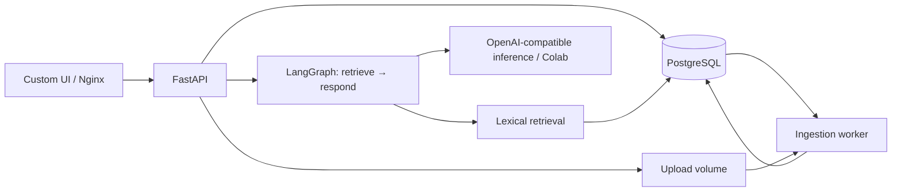

# Kiến trúc đang triển khai

Ngày 13/10/2026. Bản khung đã có code chạy local: custom UI theo nguyên lý
Hermes, FastAPI, LangGraph, ingestion worker và PostgreSQL/pgvector. Source
Streamlit cũ giữ nguyên để đối chiếu; không được import vào backend mới.

**Yêu cầu cập nhật:** giữ gần đầy đủ Hermes WebUI, cả skills/memory/usage và
agent activity. [Full workbench architecture](hermes-full-workbench.md) là
hướng migration mới; nội dung dưới đây mô tả khung kiểm chứng đang có code,
không phải full Hermes parity.

## Ranh giới code thật

| Module | File chính | Trách nhiệm / điểm thay thế |
| --- | --- | --- |
| Integration | [main.py](../../backend/app/main.py), [turns.py](../../backend/app/integration/turns.py) | HTTP, ownership, idempotency, lưu lượt chat |
| Projects/scopes | [scopes.py](../../backend/app/projects/scopes.py), [catalog.py](../../backend/app/integration/catalog.py) | File dùng chung theo Project, file riêng theo session, di chuyển chat và kiểm tra scope |
| Documents | [ingest.py](../../backend/app/documents/ingest.py) | PDF/TXT → chunks có trang |
| Retrieval | [search.py](../../backend/app/retrieval/search.py) | `search(factory, owner_id, document_ids, query, session_id=...)` → sources đúng scope; thay bằng pgvector/hybrid sau |
| Generation | [provider.py](../../backend/app/generation/provider.py) | OpenAI-compatible SSE; cấu hình Colab/GPU qua env |
| RAG | [graph.py](../../backend/app/rag/graph.py) | Retrieve, ghép history/context, gọi model; graph theo request |
| Jobs | [worker.py](../../backend/app/jobs/worker.py) | Claim lease, xử lý trong process riêng, publish có fencing |
| Storage/bootstrap | [storage.py](../../backend/app/storage.py), [migrations](../../backend/migrations/versions/0001_initial.py) | Schema dùng chung, Alembic versioned migrations |

Không tạo microservice cho từng bước RAG. API và worker dùng cùng image,
tách process để scale ingestion độc lập. Thay retrieval/model không phải
đổi UI; contract là [API/SSE](api.md).

## Đã có và giới hạn

- PostgreSQL lưu sessions/messages/documents/chunks/jobs/turns; file nằm ở
  volume dùng chung. Chunks publish cùng transaction với trạng thái ready.
- [Project/session files](projects-and-files.md): Project gom nguồn chung và
  các chat; file đính kèm session giữ riêng. Dùng chung DB/worker/retrieval,
  không tạo một service hoặc index riêng cho từng Project.
- PDF có text và TXT UTF-8; 20 MB/file, 100 trang PDF, 2 triệu ký tự text,
  extraction deadline 60 giây. PDF scan báo cần OCR, không tự đánh dấu ready.
- Tìm kiếm từ khóa theo giao từ trong query/chunk, top 5; đọc tối đa 5.000
  chunks của tài liệu được chọn. Đây là baseline, chưa có semantic embedding,
  reranking hoặc tìm kiếm tiếng Việt không dấu. pgvector extension được cài
  nhưng chưa có vector index; chọn nhiều tài liệu lớn có thể vượt scan cap.
- History được lưu thật; input context giới hạn **ký tự**, chưa kiểm ngân
  sách bằng tokenizer model. Cần kiểm tra context window của model thật.
- Model chưa cấu hình → HTTP 503 / UI khóa gửi. URL đã cấu hình không chứng
  minh provider đang online; lỗi inference được trả qua SSE error.
- Identity `local` chỉ cho phát triển một người. `APP_ENV` khác development
  bị từ chối khi API/worker khởi động. Chưa có login/RBAC/multi-tenant,
  production readiness hoặc SLA Colab.
- Không có streaming resume, physical document purge/reindex hay auto retry lỗi
  model. UI render plaintext an toàn; Markdown là một lát cắt riêng sau.

## Hướng mở rộng theo nhu cầu

1. Nối Colab và kiểm chứng stream/context với model thật; thêm tokenizer
   adapter và benchmark negative cases trước khi tăng context.
2. Thêm embedding adapter, schema vector dimension/model/version và dense
   retrieval vào `retrieval`; so sánh chất lượng với baseline từ khóa.
3. Auth server-side: thay local owner bằng verified identity dependency,
   propagation qua API/jobs/source reads, kiểm thử quyền giữa người dùng.
4. Nếu upload/storage lớn: thay shared volume bằng object storage; parser,
   OCR và embedding vẫn nằm trong documents/worker cho đến khi có nhu cầu
   tài nguyên khác nhau đủ rõ để tách worker queues.
5. Thêm metrics, queue lag, tracing có redaction, backup/restore, rate limits,
   load/concurrency tests và deploy nhiều API replicas qua load balancer.

Đọc [frontend/Hermes](frontend.md), [memory](memory.md), [Docker/vận hành](deployment.md) và
[nguồn tham khảo](../ref/README.md). [Thiết kế trước khung](../archive/2026-10-12-pre-skeleton/architecture.md)
được archive để tránh nhầm roadmap với phần đã làm.
