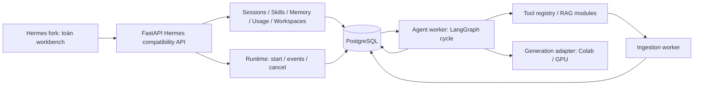

# Giữ gần đầy đủ Hermes WebUI và backend có thể scale

**Cập nhật UX ngày 13/10/2026:** các capabilities dưới đây vẫn là hướng
backend/runtime; shell hiện tại theo luồng ChatGPT để dễ dùng hơn. Xem
[frontend hiện hành](frontend.md) và [nghiên cứu UX](../ref/chatgpt-webui-research.md).
Không dùng bố cục hoặc các controls của snapshot upstream để quyết định
thao tác nào phải hiện trong màn hình chat chính.

Quyết định cập nhật ngày 12/10/2026 theo yêu cầu mới: **fork gần toàn bộ
workbench Hermes**, giữ composer, sidebar/history, skills, memory, usage,
profiles, workspace, activity và các controls hiện có. Không tiếp tục lấy
bản UI rút gọn làm mục tiêu feature parity.

Backend đích vẫn FastAPI/LangGraph + PostgreSQL như hướng trước. Đây là
thiết kế migration có bằng chứng source; full feature parity chưa được
triển khai. Bản khung API/RAG và UI nhỏ đang chạy là lát cắt kiểm chứng,
không phải bằng chứng rằng toàn bộ Hermes đã nối backend mới.

## Source đã mang vào repository

`vendor/hermes-webui/` chứa nguyên 2.129 tracked files từ commit
`9e380c2da93463c813cb58dd57f11b75a21626b2`, nhập bằng git archive. Có UI,
backend, contracts, Docker, scripts và tests upstream; không có `.git`,
personal state hoặc credentials. Các files đã đối chiếu byte với reference.
[Source lock](../../vendor/hermes-webui.source.json) ghi provenance.

`references/hermes-webui/` vẫn là checkout nguyên trạng để đối chiếu;
`vendor/` là snapshot được track để không mất code khi fresh clone.
Không import vendor Python vào backend DocuminChat hoặc chạy bootstrap
ngầm. Upstream tests là source test được giữ lại, chưa được chạy trong phiên
này; tests backend/UI DocuminChat là bộ riêng.

## Những điều đã xác minh từ source

| Nhóm | Source cố định | Hệ quả cho migration |
| --- | --- | --- |
| UI đầy đủ | [index](../../vendor/hermes-webui/static/index.html), [panels](../../vendor/hermes-webui/static/panels.js) | Giữ các panels và handlers; không viết lại toàn bộ từ đầu |
| API coupling | [workspace api helper](../../vendor/hermes-webui/static/workspace.js), [inventory](../ref/hermes-ui-api-inventory.json) | 182 literal URL paths; có paths động/comments nên số này không phải coverage của mọi endpoint |
| Stream chat | [messages](../../vendor/hermes-webui/static/messages.js) | POST `/api/chat/start`, GET EventSource `/api/chat/stream`; khác POST SSE `delta/sources/done` của khung mới |
| Agent cycle | [streaming](../../vendor/hermes-webui/api/streaming.py), [agent runtime](../../vendor/hermes-webui/api/agent_runtime.py) | WebUI gọi `AIAgent.run_conversation` từ Hermes Agent; clone WebUI không tự mang implementation agent loop đó |
| Skills | [panels](../../vendor/hermes-webui/static/panels.js), [routes](../../vendor/hermes-webui/api/routes.py), [skill usage](../../vendor/hermes-webui/api/skill_usage.py) | UI có list/toggle/edit/save/delete; native backend dùng profile skill files và `.usage.json` |
| Memory | [routes](../../vendor/hermes-webui/api/routes.py) | Native đọc/ghi `memories/MEMORY.md`, `USER.md`, phụ thuộc profile; không phải chat history |
| Usage | [usage](../../vendor/hermes-webui/api/usage.py), [metering](../../vendor/hermes-webui/api/metering.py) | Phải tách usage tokens/cost với live stream metering; không tính token bằng số SSE packets |
| External runtime | [runner client](../../vendor/hermes-webui/api/runner_client.py), [runtime adapter](../../vendor/hermes-webui/api/runtime_adapter.py) | Có start/events/status/cancel seam; không thay mọi session/auth/skills/memory routes bằng cấu hình |
| Storage/run durability | [models](../../vendor/hermes-webui/api/models.py), [run journal](../../vendor/hermes-webui/api/run_journal.py) | JSON/SQLite/file journals + process-local registries không phải PostgreSQL multi-replica store |

Audit dependency chính thức upstream đã chạy bằng static AST, kết quả ở
[hermes-agent-dependencies.json](../ref/hermes-agent-dependencies.json).
Đọc [agent source dependency contract](../../vendor/hermes-webui/docs/architecture/agent-api-contract.md)
và [run adapter RFC](../../vendor/hermes-webui/docs/rfcs/hermes-run-adapter-contract.md).
RFC có cả proposal và shipped slices; không suy mọi phần đã hoàn thành.

Đối chiếu thêm Hermes Agent upstream tại commit
`7cc3fb8cb55898747dd1dfa56fda3e16ebba028e`: [turn facade](https://github.com/NousResearch/hermes-agent/blob/7cc3fb8cb55898747dd1dfa56fda3e16ebba028e/agent/turn_facade.py)
forward sang [conversation loop](https://github.com/NousResearch/hermes-agent/blob/7cc3fb8cb55898747dd1dfa56fda3e16ebba028e/agent/conversation_loop.py),
tách model call, tool round và finalization. Đây là source evidence, không
phải runtime đã install hay version pair đã kiểm chứng với WebUI snapshot.

## Kiến trúc đích cụ thể



Compat chỉ dịch contracts Hermes sang services của DocuminChat; không sở hữu
agent instances, queue/cancellation maps hoặc một kho history khác. Tách
**module** trước, tách deployment khi có tài nguyên/throughput cần riêng:

| Module đích | Authority | Deployment ban đầu |
| --- | --- | --- |
| sessions/projects/profiles | Owner/workspace/session/message metadata trong PostgreSQL | API |
| skills | Versioned content, enabled state, scope; runtime đọc version xác định | API + agent worker đọc |
| memory | Scope user/workspace/profile; retention và version; khác messages/checkpoints | API + agent worker |
| usage | Usage ledger theo run/model/provider; số thật hoặc unknown | Agent worker ghi, API query |
| runtime | Runs, events, ownership/lease/cancel/approval state | API điều khiển + agent worker |
| tools/RAG | Tool schema/permission, documents/retrieval/generation | Giữ 6 nhóm RAG của khung hiện tại |
| ingestion | Durable document jobs và indexes | Worker riêng đã có |

Skills/memory/usage không cần mỗi nhóm một HTTP service. Native Hermes state
không được trở thành source of truth thứ hai. Khi cần import data native,
dùng explicit importer và mapping IDs, không dual-write ngầm.

## Streaming và agent cycle

Contract nội bộ cần envelope có `run_id`, `session_id`, `seq`, `type`,
timestamp và payload version. Run events ghi append-only trong PostgreSQL;
SSE đọc từ cursor (`Last-Event-ID`/after_seq). Runtime ghi; UI trình bày.
Compat ánh xạ sang wire names Hermes `token`, `tool`, `tool_complete`,
`state_saved`, `done`, `stream_end`, `cancel`, `apperror` và events khác theo
capability. Không đổi tên `delta` thành `token` rồi coi là tương thích.

Agent cycle cần implement và test thật:

```text
accept turn → claim run → build context + skill/memory versions
→ model stream → tool calls? → validate/execute tools → persist tool results
→ model tiếp → final answer / stop / failed / limit reached
```

Graph retrieve→respond hiện tại **chưa phải tool-calling agent cycle**.
Vòng lặp mới cần step/time/token limits, tool schema, owner scope, side-effect
policy và terminal settlement. Agent worker có lease/fencing; API restart
không làm mất authority của run đang chạy. Pub/sub có thể làm wakeup sau,
PostgreSQL run/event store mới là authority; chưa cần Redis/Kafka ngay.

- Đổi session/đóng tab chỉ detach view; **Stop** là control request rõ ràng.
  Khung hiện tại abort HTTP khi đổi session; phải đổi semantics khi nối Hermes.
- Reconnect replay events, không re-POST user prompt hoặc tạo một agent run
  mới. Dedup theo run+seq; model/tool side effects không có exactly-once
  guarantee tự nhiên, cần idempotency riêng khi tool có side effect.
- Worker chết giữa tool execution: giữ trạng thái interrupted/unknown và
  evidence; không tự lặp tool có side effect như một text completion retry.
- Steer/queue/approval chỉ bật khi runtime có contract và lifecycle test
  tương ứng; giữ source UI cho các controls nhưng không trả accepted giả.
- Provider không báo token usage → unknown, không đổi chars/deltas thành
  tokens hay chi phí. Prices cần version/timestamp để ledger tái lập.

## Thứ tự triển khai và điều kiện nghiệm thu

1. **Đã làm:** vendor full source, audit dependencies/API, giữ prototype
   Docker RAG thật và PostgreSQL history; pin/archive API trong migration0002.
2. Port shell/composer/history **nguyên UI** qua compatibility API, giữ các
   panels. Nghiệm thu desktop/mobile, persistent history và module API map.
3. Runtime runs/events/cancel + agent cycle allowlisted RAG tools. Nghiệm thu
   tool calls thật, duplicate start, reconnect, API restart, lease expiry,
   cancel versus completion và late worker fencing.
4. Nối skills CRUD/version, memory CRUD/scope và usage ledger vào các panels
   đã có. Nghiệm thu editor save/reload, version used by run, tenant isolation
   và usage unknown/provider-report cases.
5. Workspaces/profiles, attachments, tool activity, approval/steer/queue,
   schedules/terminal/plugins theo capability map; giữ hết source, nối từng
   vertical slice để không tạo management buttons làm việc giả.
6. Auth, object storage, load/backup tests; test 2 API + 2 agent workers trước
   khi gọi horizontal scale. Ingestion worker đang có không chứng minh
   runtime worker đã scale.

### Đánh giá

Giữ gần toàn bộ frontend là khả thi và đúng hướng reuse người dùng chọn.
Full WebUI + Hermes Agent native giúp có feature parity nhanh, nhưng storage
và execution ownership cần migration trước khi đáp ứng kiến trúc scale đã
chốt. Với backend riêng, khối lượng chính là contracts/state/runtime, không
phải CSS. Snapshot và inventories hiện có là nền cụ thể cho việc đó; chưa
có bằng chứng production hoặc full Hermes parity trong khung hiện tại.
